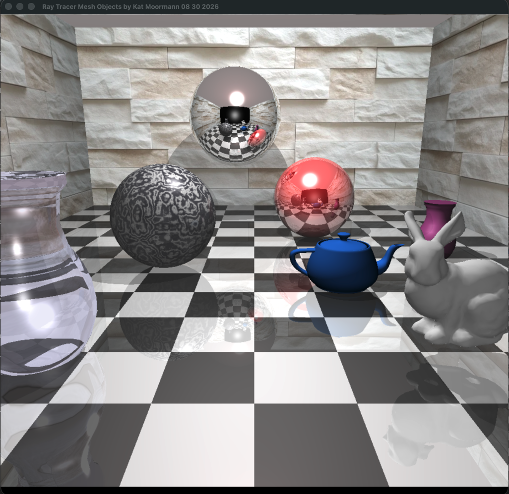
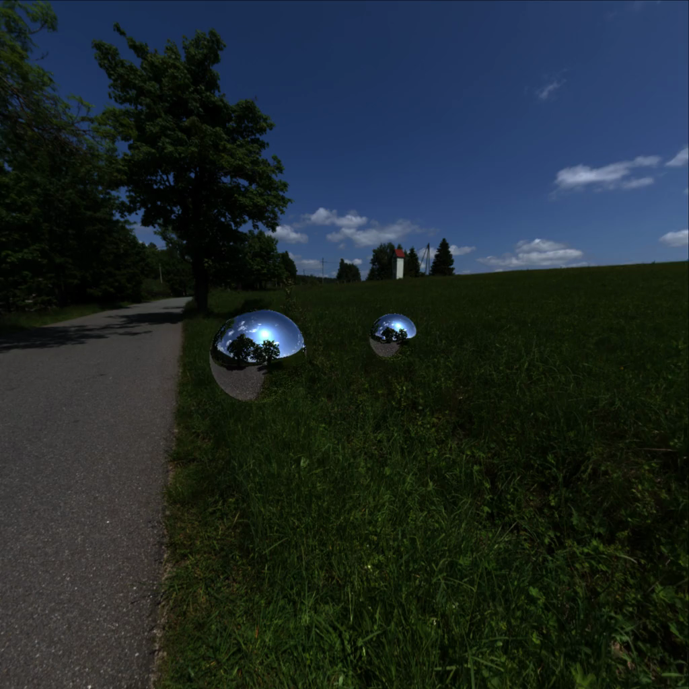
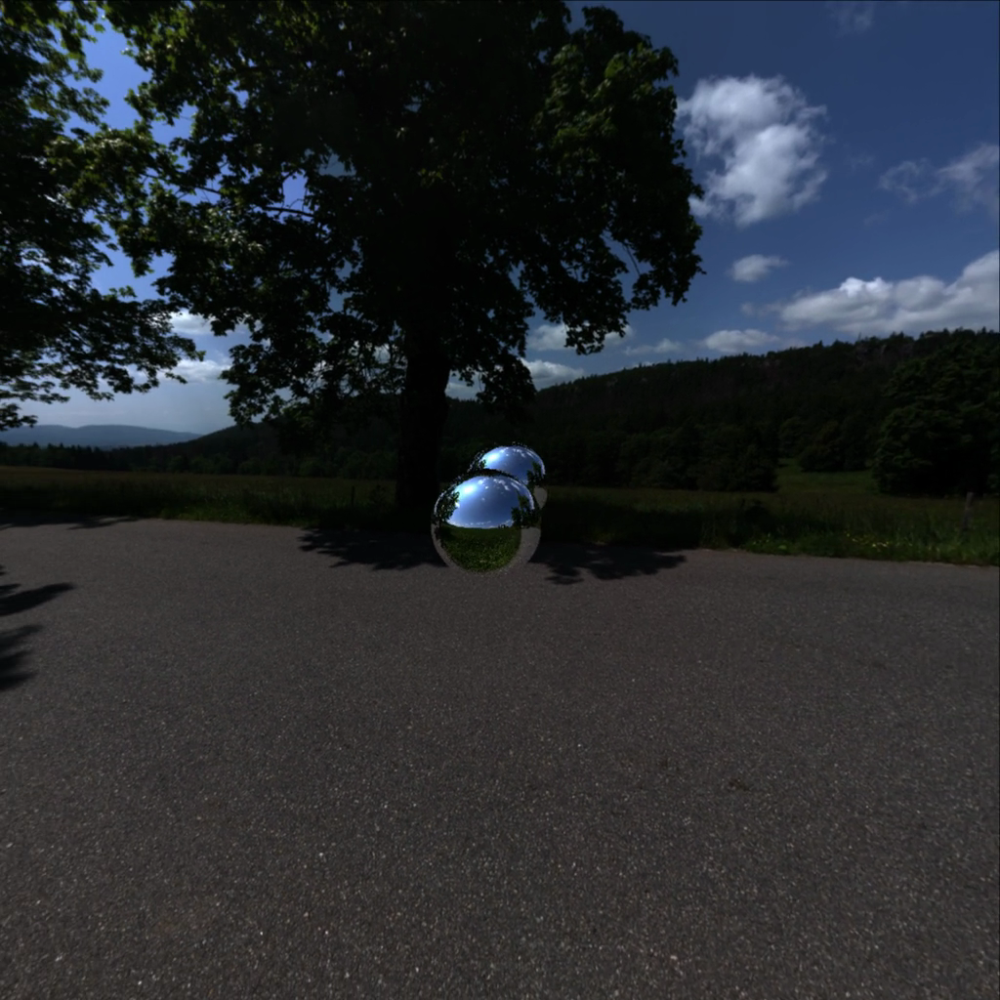
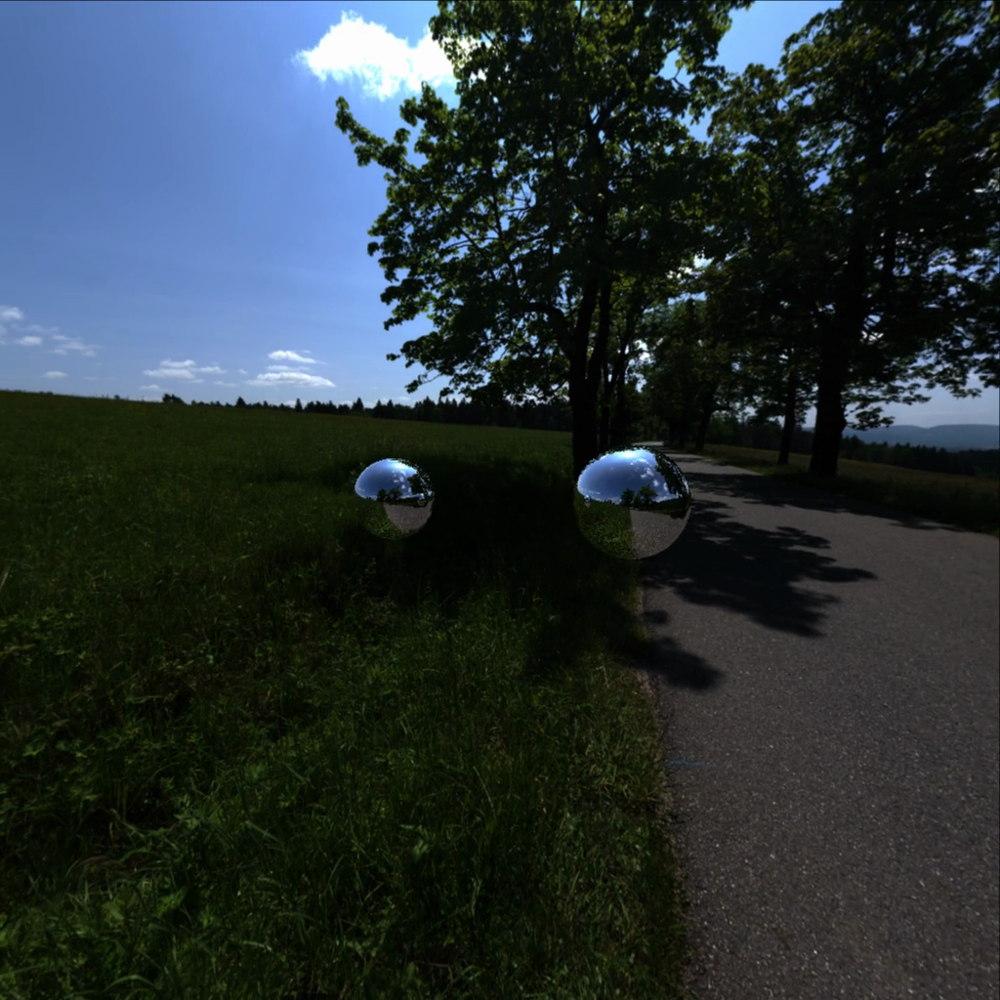

# Kat Moormann

**Graphics Programming / 3D Rendering / Game Development**

---

## Ray Tracer

A ray tracing renderer exploring lighting, reflections, and 3D scene rendering.

### Rendered Scene

### Camera Orbit

Multiple perspectives of the rendered scene captured during a camera orbit.

| Initial View | Rotated View | Alternate Angle |
|:---:|:---:|:---:|
|  |  |  |

---

## Other Projects

**[3D Scenes](https://github.com/katmoormann99/3D_scenes)** — 3D environments and rendering experiments.

**[Game Engine](https://github.com/katmoormann99/game-engine)** — Game engine architecture and development.

**[Graphics Sandbox](https://github.com/katmoormann99/graphics-sandbox)** — Graphics programming and rendering experiments.